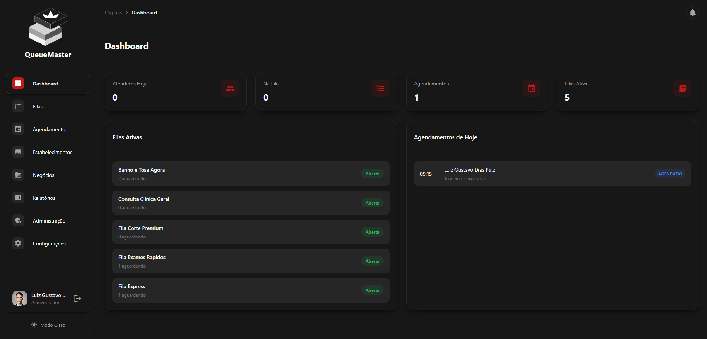
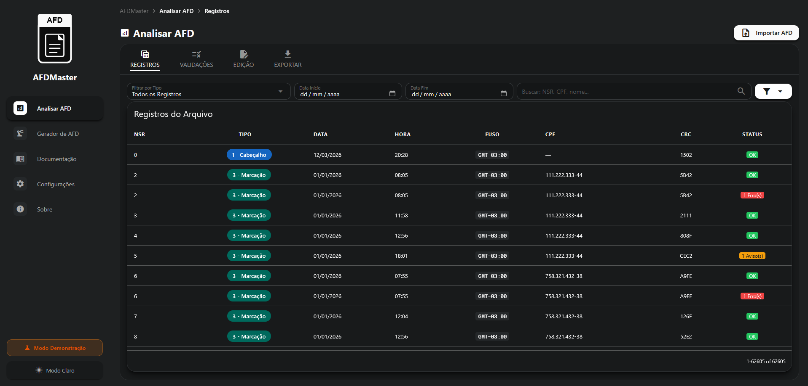

<!-- Banner Dinâmico Venom com Paleta Idêntica ao Rodapé -->

<!-- Badges de Acesso Rápido (Rounded) -->

  
  

---

<h3 align="center">⚡ Sobre Mim & Filosofia de Engenharia</h3>

  <em>"O conhecimento dita o código. Sistemas resilientes, arquitetura limpa e precisão técnica."</em>

Desenvolvedor Full-Stack e Arquiteto de Software focado em transformar problemas operacionais e de negócio complexos em software previsível, veloz, seguro e auditável — de aplicações web modernas a motores de processamento de dados e automação assíncrona.

- 🏛️ **Arquitetura & Engenharia de Software:** Aplicação prática de *Domain-Driven Design* (DDD), *Clean Architecture*, separação estrita de responsabilidades e registro contínuo de decisões técnicas via **ADRs** (*Architectural Decision Records*).
- 📚 **Documentação & SSOT:** Engenharia orientada a documentação como Fonte Única da Verdade. O código nasce primeiro a partir de modelo de domínio, restrições e alinhamento de arquitetura antes da implementação.
- 🤖 **IA & Protocolos Abertos (MCP):** Engenharia de integrações autônomas e servidores **MCP** (*Model Context Protocol*) em TypeScript para orquestração de LLMs (NVIDIA NIM), automações headless e ferramentas corporativas.

---

<h3 align="center">🛠️ Matriz de Tecnologias & Especialidades</h3>

| Camada / Domínio | Especialidades & Aplicação Prática | Ecossistema & Ferramentas |
| :--- | :--- | :---: |
| **Frontend & UI** | Interfaces reativas, SSR/SSG de alta performance, SPAs modernas e sistemas de design utilitários. <b>Stack:</b> Vue 3 · Quasar · TypeScript · Astro · Tailwind CSS · React · Vite · SASS |  |
| **Backend & Sistemas** | APIs modulares, daemons assíncronos, migrações de dados em memória e arquiteturas orientadas a eventos. <b>Stack:</b> Node.js · NestJS · C# (.NET 8) · PHP 8 · Express · Python |  |
| **Bancos de Dados** | Modelagem relacional estrita, integridade referencial, queries de alta precisão e caching distribuído. <b>Stack:</b> PostgreSQL · SQL Server · MariaDB · MySQL · SQLite · Prisma ORM · Redis |  |
| **DevOps & Infra** | Containers hardened, automação CI/CD, servidores Linux, proxy reverso e protocolos de IA. <b>Stack:</b> Docker · Linux / VPS · GitHub Actions · Nginx · Cloudflare · Git · Postman |  |

---

<h3 align="center">🎯 Vitrine Técnica & Projetos em Destaque</h3>

<table>
  <tr>
    <td width="50%" valign="top">
      <h4 align="center"><b>QueueMaster</b></h4>
      
<em>Sistema Híbrido de Filas & Agendamentos em Tempo Real</em>

      
        
      

        Plataforma unificada que orquestra filas físicas (<em>walk-ins</em>) e atendimentos marcados com priorização determinística, atualizações em tempo real via <b>Server-Sent Events (SSE)</b> e autenticação Google OAuth 2.0 com tokens JWT RS256.
      

      

        
        
        
        
        
      

      

        <a href="https://github.com/luizGDpulz/QueueMaster"><b>Explorar Repositório no GitHub ↗</b></a>
      

    </td>
    <td width="50%" valign="top">
      <h4 align="center"><b>AFDMaster</b></h4>
      
<em>Análise, Validação & Síntese de Arquivos Fiscais</em>

      
        
      

        Aplicação <em>Zero-Backend</em> (Privacy-First) em memória para inspeção posicional, conformidade legal de ponto eletrônico (REP) e recálculo determinístico de checksum <b>CRC-16</b> sem risco de vazamento de dados trabalhistas sensíveis.
      

      

        
        
        
        
        
      

      

        <a href="https://github.com/luizGDpulz/AFDMaster"><b>Explorar Repositório no GitHub ↗</b></a>
      

    </td>
  </tr>
  <tr>
    <td width="50%" valign="top">
      <h4 align="center"><b>mcp-nvidia-nim</b></h4>
      
<em>Model Context Protocol Server para NVIDIA NIM</em>

      

        Servidor MCP em TypeScript para orquestração de LLMs de última geração (Nemotron 550B, Mistral Large, Llama 3.2 Vision) com <em>fallback chains</em> automáticas para raciocínio profundo, revisão de código e visão computacional.
      

      

        
        
        
        
      

      

        <a href="https://github.com/luizGDpulz/mcp-nvidia-nim"><b>Explorar Repositório no GitHub ↗</b></a>
      

    </td>
    <td width="50%" valign="top">
      <h4 align="center"><b>sidepot-poker</b></h4>
      
<em>Motor Matemático de Side Pots & Gestão de Fichas</em>

      

        Motor determinístico com algoritmo de fatiamento iterativo para múltiplos potes paralelos (<em>side-pots</em>) em situações de <em>all-in</em> assimétrico, validação estrita de invariância de conservação de fichas e testes unitários rigorosos.
      

      

        
        
        
        
      

      

        <a href="https://github.com/luizGDpulz/sidepot-poker"><b>Explorar Repositório no GitHub ↗</b></a>
      

    </td>
  </tr>
</table>

  
<b>🔍 Outros Projetos & Ferramentas Corporativas</b>

   

| Projeto | Domínio / Arquitetura | Stack Principal | Link |
| :--- | :--- | :--- | :---: |
| **Secullum DB Migrations** | Pipeline de migração in-memory com resolução de grafo de chaves estrangeiras, imutabilidade da base legada e integridade estrita. | `C#` `.NET 8` `SQL Server` | *Privado / Core* |
| **pulz.dev.br** | Plataforma de engenharia e portfólio pessoal com renderização SSG em Astro, internacionalização completa e sync de repositórios. | `Astro` `TypeScript` `Tailwind CSS` | [pulz.dev.br ↗](https://pulz.dev.br) |
| **mcp-spotify-curator** | Curadoria autônoma de playlists e inteligência musical via Model Context Protocol. | `TypeScript` `Spotify API` `MCP` | [Repositório ↗](https://github.com/luizGDpulz/mcp-spotify-curator) |

---

<h3 align="center">📊 Métricas & Atividade no GitHub</h3>

<!-- Cards de Estatísticas com Estilo Consistente GitHub Dark -->

  
  

<!-- Menu Expansível / Recolhível da Cobrinha -->

  
<b>🐍 Contribuições (Expandir / Recolher)</b>

   
  <picture>
    <source media="(prefers-color-scheme: dark)" srcset="https://raw.githubusercontent.com/luizGDpulz/luizGDpulz/output/github-contribution-grid-snake-dark.svg">
    <source media="(prefers-color-scheme: light)" srcset="https://raw.githubusercontent.com/luizGDpulz/luizGDpulz/output/github-contribution-grid-snake.svg">
    
  </picture>

---

<h3 align="center">📫 Conecte-se comigo</h3>

  
  
  
  

 

